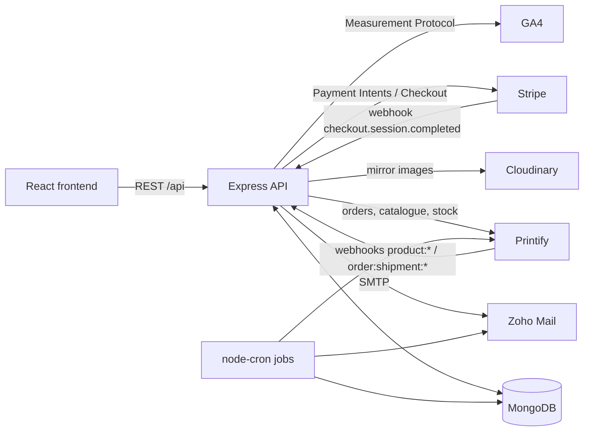

# Cuñadismo Ilustrado · Backend

REST API behind **Cuñadismo Ilustrado**, a print-on-demand shop selling Spanish humour t-shirts and merch. It handles the catalogue, Stripe payments, Printify fulfilment, transactional email, the newsletter and an admin panel.

> **The shop is closed.** It ran in production from August 2025 to mid 2026 (frontend at `cunadismoilustrado.me`, API on Heroku). The domain has expired, so there is no live demo. The revenue it made through Stripe is verified on TrustMRR:
>
> <a href="https://trustmrr.com/startup/cunadismo-ilustrado"></a>

Frontend (React + Vite): [CodeInIA/cunao-frontend](https://github.com/CodeInIA/cunao-frontend)

## What it does

- **Catalogue synced from Printify.** Products are created and removed through Printify webhooks, stored in MongoDB and kept in stock sync by a scheduled job. Mockup images are mirrored to Cloudinary.
- **Checkout with Stripe.** Payment Intents and Checkout Sessions, shipping cost by region (Spain / rest of Europe, free shipping above a threshold) and discount codes on the subtotal or on shipping.
- **Fulfilment with Printify.** Once Stripe reports the session as paid, the order is created in Printify (optionally sent straight to production). Shipment webhooks trigger "shipped" and "delivered" emails.
- **Email and newsletter.** Order emails via Zoho SMTP, subscribers with per-user preferences and HMAC-signed preference/unsubscribe links, a weekly newsletter, a weekly "new products" email and scheduled discount campaigns.
- **Reviews.** The delivery email carries a tokenised link to leave a review with photos. Reviews are moderated before they are published.
- **Admin API.** JWT login in an httpOnly cookie with CSRF double-submit protection: reviews, product tags, discount codes, newsletter subscribers and a small customer CRM with stats.
- **Analytics.** Server-side events forwarded to the GA4 Measurement Protocol.
- **Hardening.** Helmet, rate limiting, CORS allow-list, express-validator, and raw-body signature checks on the Stripe and Printify webhooks.

## Architecture



Order flow:

1. The frontend creates a Checkout Session (`POST /api/orders/checkout-session`) and the order is stored as pending.
2. The customer pays on Stripe. Stripe calls `POST /api/webhooks/stripe` with `checkout.session.completed`, and the API records customer, shipping, totals and discount usage.
3. `POST /api/orders/process` checks with Stripe that the session is `paid` and creates the order in Printify.
4. Printify sends `order:shipment:created` and `order:shipment:delivered`, and the API emails the customer (the delivery email includes the review link).
5. Pending (unpaid) orders older than 24 h are removed by the nightly cleanup job.

## Tech stack

| Area | Tools |
|------|-------|
| Runtime | Node.js, Express 5, TypeScript (ESM) |
| Data | MongoDB, Mongoose |
| Payments | Stripe |
| Print on demand | Printify REST API |
| Media | Cloudinary, sharp, multer |
| Email | Nodemailer (Zoho SMTP) |
| Auth and security | JWT, bcryptjs, helmet, express-rate-limit, express-validator, cors |
| Scheduling | node-cron |
| Testing | Jest, ts-jest, Supertest, nock, mongodb-memory-server |
| CI / hosting | GitHub Actions, Heroku (`Procfile`) |

## API overview

All routes are under `/api`, plus `GET /health`.

| Prefix | Purpose |
|--------|---------|
| `/products` | List, featured, search, detail, variants, GPSR info |
| `/orders` | `payment-intent`, `checkout-session`, `process`, `shipping`, `:orderId/status` |
| `/discounts` | Validate and look up discount codes |
| `/config` | Shipping configuration for the frontend |
| `/newsletter` | Subscribe, validate token, update preferences, unsubscribe |
| `/reviews` | Validate review token, submit review with photos, list, moderate |
| `/weekly-products` | Weekly "new products" selection and email |
| `/images` | Regenerate product images on Cloudinary |
| `/contact` | Contact form |
| `/analytics` | GA4 event collection |
| `/admin` | Login/logout, reviews, product tags, discount codes, subscribers, clients |
| `/webhooks` | `stripe` and `printify` (raw body, signature verified) |

## Project structure

```
src/
├── server.ts        # Express app, middleware, route mounting, schedulers
├── routes/          # One router per API area
├── controllers/     # Request handlers
├── services/        # Stripe, Printify, MongoDB (Product/Order schemas), Cloudinary, email
├── models/          # Mongoose models: Client, DiscountCode, Newsletter, Review, User, WeeklyProducts
├── cron/            # Scheduled jobs and manual CLI tasks
├── middleware/      # Admin auth, CSRF, error handler
├── types/
├── utils/
└── __tests__/       # Unit and integration tests
scripts/createAdmin.ts       # Seeds the first admin user
webhook-hash-calculator.js   # Signs sample Printify webhook payloads for local testing
.github/workflows/           # CI: type check, build and test suites
```

## Running locally

Requirements: Node.js 20.19 or newer (CI uses Node 24) and a MongoDB instance. Stripe, Printify, Cloudinary and SMTP credentials are only needed for the features that use them.

```bash
npm ci
cp .env.example .env     # fill in your own values
npm run dev              # tsx watch, http://localhost:3001
```

Every environment variable the code reads is listed in [`.env.example`](.env.example). To receive Stripe webhooks locally: `stripe listen --forward-to localhost:3001/api/webhooks/stripe`.

| Script | What it does |
|--------|--------------|
| `npm run dev` | Start the API with hot reload (tsx) |
| `npm run build` | Compile TypeScript to `dist/` |
| `npm start` | Run the compiled server |
| `npm test` | Run the Jest suite |
| `npm run cleanup-orders` | Delete pending orders older than 24 h now |
| `npm run create-discount` | Interactive CLI that creates a discount code and emails it to subscribers |
| `npm run cancel-orders` | Cancel every pending / on-hold order in Printify |
| `npx tsx scripts/createAdmin.ts` | Create the first admin from `INIT_ADMIN_EMAIL` / `INIT_ADMIN_PASS` |

## Scheduled jobs

All of them are started from `server.ts` on boot. Times are server time.

| Job | File | Schedule |
|-----|------|----------|
| Printify stock sync | `cron/syncProductStock.ts` | Every 30 min, plus once 15 s after boot |
| Scheduled discount activation | `cron/activateScheduledDiscounts.ts` | Every minute |
| Expired order cleanup | `cron/cleanupExpiredOrders.ts` | Daily at 02:00 (production only) |
| Weekly newsletter | `cron/weeklyNewsletter.ts` | Saturdays 18:00 (production only) |
| Weekly new products email | `cron/weeklyNewProducts.ts` | Sundays 18:00 (production only) |

## Testing

```bash
npm test
```

13 suites and 119 tests: controllers (orders, products, admin, newsletter, contact, analytics, webhooks), models, the Stripe and email services, image utilities, and an end-to-end purchase flow against an in-memory MongoDB with external APIs mocked. No real credentials are needed. GitHub Actions runs the type check, the build and the test suites on push.

## License

All rights reserved. The source is public for portfolio and review purposes only. See [LICENSE](LICENSE).

Author: Sergio Barrios Paz ([@CodeInIA](https://github.com/CodeInIA))
